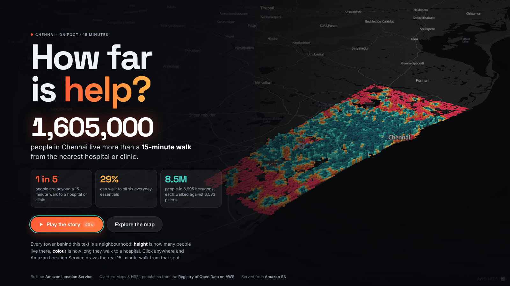
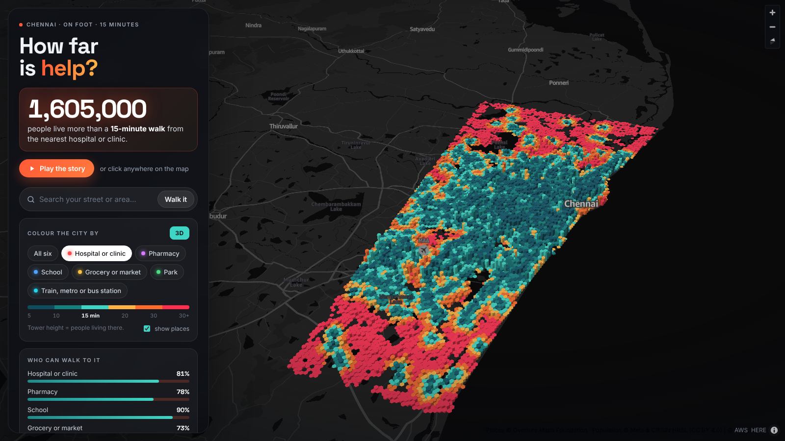
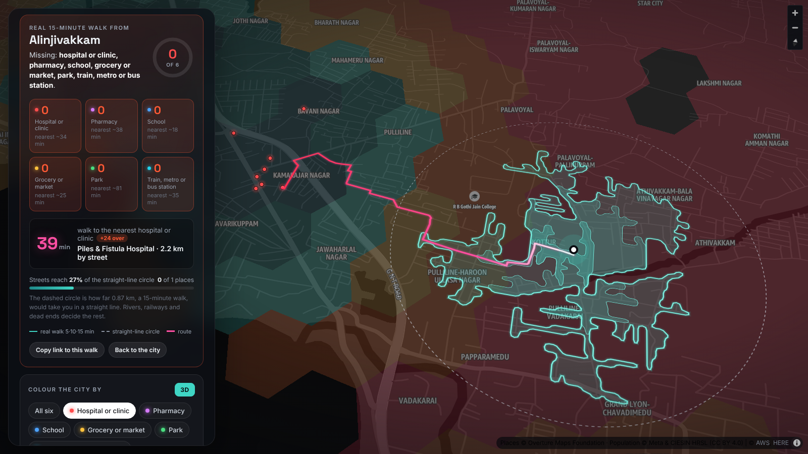
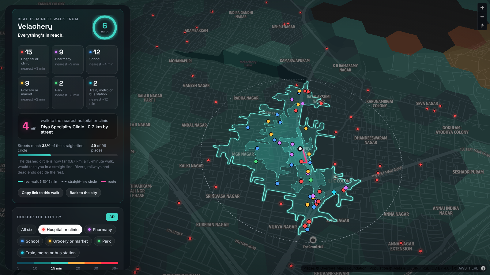
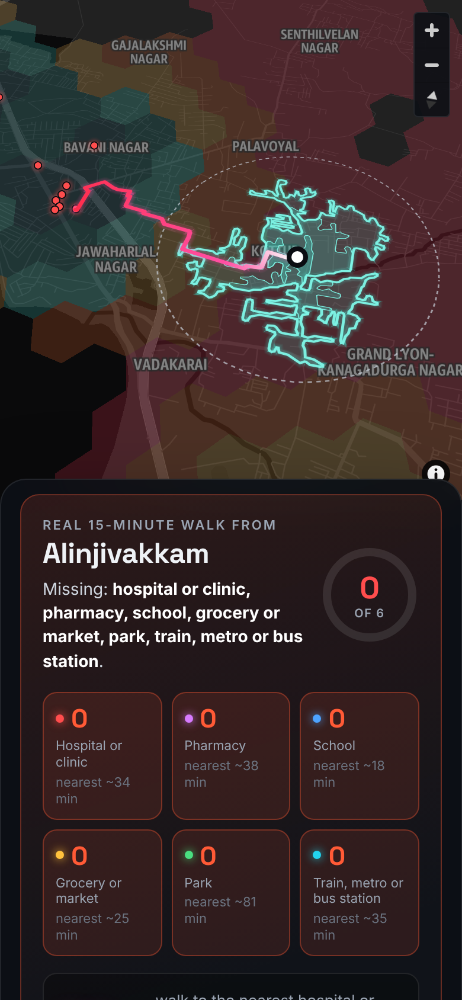
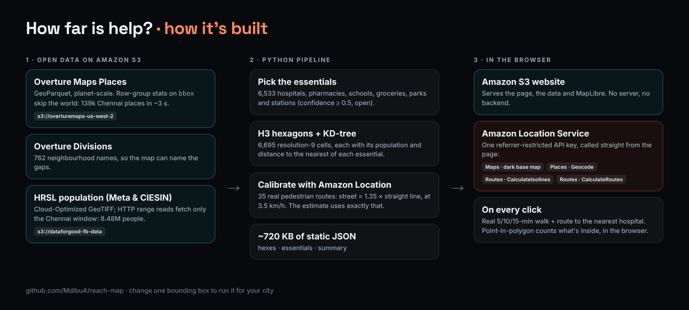

# How far is help? I mapped every 15-minute walk in Chennai with Amazon Location Service



**About 1.6 million people in and around Chennai, roughly 1 in 5, live more than a 15-minute walk from the nearest hospital or clinic.** I built a map that shows where they live, and lets anyone click their own street to see the real walk.

- **Live map:** http://reachmapbucket.s3-website-us-east-1.amazonaws.com
- **Code:** https://github.com/MdIbuA/reach-map
- **Demo (2:40):** VIDEO_URL

---

## The question

"Is there a hospital near me?" sounds like a distance question. It's really a walking question.

In Chennai, a clinic 600 m away can be across the Adyar, a railway line or a gated campus, and that 600 m becomes a 25-minute walk. Plenty of people here don't have a two-wheeler, and nobody wants to look for an auto at 2 a.m. I wanted a map that answers the walking question for every part of my city, and that people can check against the streets they actually know.

## The data: two open datasets, read straight from S3

Both datasets come from the **Registry of Open Data on AWS**. I never downloaded either one in full.

| Dataset | What I used | How it's read |
|---|---|---|
| **Overture Maps Places** (release 2026-10-21.0) | 139,332 places in the Chennai box. I kept 6,533 everyday essentials: hospitals and clinics, pharmacies, schools, groceries and markets, parks, and train, metro and bus stations. | GeoParquet on `s3://overturemaps-us-west-2`, filtered on its `bbox` column |
| **Overture Maps Divisions** | 762 neighbourhood names, so the map can say *where* the gaps are | Same release |
| **High Resolution Settlement Layer** (Meta & CIESIN) | Population per ~30 m cell: 8.48 million people in the box | Cloud-Optimized GeoTIFF on `s3://dataforgood-fb-data`, HTTP range reads |

The trick that makes this cheap is **predicate pushdown**. Overture's Places file covers the whole planet, but every Parquet row group stores min/max statistics for `bbox`. pyarrow skips every row group that can't touch Chennai:

```python
fs = pf.S3FileSystem(anonymous=True, region="us-west-2")
dataset = ds.dataset(f"overturemaps-us-west-2/release/{RELEASE}/theme=places/type=place/",
                     filesystem=fs, format="parquet")
b = lambda k: ds.field("bbox", k)
table = dataset.to_table(columns=cols, filter=(b("xmin") >= 80.12) & (b("xmax") <= 80.34)
                                            & (b("ymin") >= 12.82) & (b("ymax") <= 13.25))
```

That returns **139k places in about 3 seconds**, with no AWS account. The population raster works the same way: it's a COG, so rasterio fetches only the tiles covering the Chennai window.

## Putting it on the map



**1. Hexagons.** I summed the population into **6,695 H3 cells** (resolution 9, about 0.1 km² each). A KD-tree gives each cell the straight-line distance to the nearest place of each kind. On the map, each cell is a **tower**: height is how many people live there, colour is the estimated walk to help. Teal means under 15 minutes; orange and red means more.

**2. Amazon Location Service for the truth.** Straight lines can't see rivers or railway lines. When you click anywhere, the page calls **Amazon Location Routes** directly from the browser, with a referrer-restricted API key:

```http
POST https://routes.geo.us-east-1.amazonaws.com/v2/isolines?key=…
{ "Origin": [80.1986, 13.1928],
  "Thresholds": { "Time": [300, 600, 900] },
  "TravelMode": "Pedestrian",
  "IsolineGeometryFormat": "Simple" }
```

It returns the real 5, 10 and 15-minute walking areas. The page then:
- counts the essentials inside the 15-minute area (point-in-polygon in the browser, so it's instant and free)
- calls **CalculateRoutes** to walk you to the nearest hospital or clinic
- compares the real walk with the circle that 15 minutes would cover in a straight line

The search box uses **Amazon Location Places (Geocode)**, and the dark base map is **Amazon Location Maps**.

**Why Amazon Location?** Isolines answer exactly the question this map asks, "what can I reach on foot?", in one call. And an API key with a referrer restriction lets a static page use Maps, Places and Routes with no backend, no Cognito and no Lambda. The whole site is about 2 MB of HTML, JS and JSON served from **Amazon S3**.

## The part I'm proudest of: calibrating the estimate against real walks

My first version assumed a walking speed of 4.8 km/h and a street-detour factor of 1.35. Then I compared it with Amazon Location: I asked for **35 real pedestrian routes** from random populated hexagons to their nearest clinic (`pipeline/calibrate.py`).

- The detour factor held up exactly: the median street route was **1.35×** the straight line.
- The pace didn't. Amazon's pedestrian routing walks at **57.8 m/min (3.5 km/h)**, not 80.

So I rebuilt the city layer with the measured pace. The headline went from 988,000 people beyond a 15-minute walk to **1.6 million**. The city-wide estimate and the click-to-walk ground truth now use the same model, so the map doesn't contradict itself.

## What the map reveals



| Essential | Share of 8.48 M people within ~15 min on foot |
|---|---|
| School | 90% |
| Hospital or clinic | 81% |
| Pharmacy | 78% |
| Grocery or market | 73% |
| Train, metro or bus station | 55% |
| Park | 49% |
| **All six** | **29%** |

- **The gaps aren't in the old city.** They're on the edges where Chennai grew fastest: Alinjivakkam, Vadaperumbakkam and Manjampakkam in the north, and Sholinganallur and Nookampalayam along the southern IT corridor.
- **Alinjivakkam is the starkest case.** The real 15-minute walk reaches **none** of the six essentials. The nearest hospital is a **39-minute walk, 2.2 km by street**: 24 minutes over the line.
- **Velachery is the opposite.** The same 15 minutes reaches 15 clinics, 9 pharmacies and 12 schools, and the nearest clinic is 4 minutes away.
- **Streets decide more than distance does.** In both places the real walk covers only about a third of the straight-line circle, because rivers, railways and dead ends cut it up.



## Explore it

- **Play the story:** a 40-second guided tour flies over the city, walks Alinjivakkam and then Velachery with live data, and hands you the controls.
- **Click anywhere**, or **search your street**, to get your own walk, with a score out of six and the route to the nearest hospital.
- **Switch essentials** (hospital, pharmacy, school, grocery, park, station, or all six) and flip between 3D and 2D.
- **Share a walk:** every walk has its own link.
- **It works on phones:** the map stays pinned on top while the result scrolls underneath.



## How the pieces fit (reuse this pattern)



The pattern works for any "can people reach X?" question in any city that Overture and HRSL cover:

1. **Slice open data in place:** filter Overture GeoParquet on S3 by bounding box, and range-read the HRSL population tile.
2. **Precompute a cheap estimate:** population into H3 cells, nearest-place distance with a KD-tree.
3. **Calibrate it** against a few dozen Amazon Location routes.
4. **Check on demand:** Amazon Location isolines and routes when someone clicks.
5. **Ship it static:** S3 website hosting and a referrer-restricted key, with no server to run.

To run it for your city, change one bounding box and one raster tile name in the pipeline. The steps are in the [README](https://github.com/MdIbuA/reach-map#reuse-it-for-your-city).

## The catch

Every map makes choices, so here are mine:

- **The hexagon colours are an estimate.** The click is the ground truth for one spot.
- **Overture has gaps in India.** It misses some government health centres and many small shops, and roadside MTC bus stops aren't in it at all. "Hospital" includes private nursing homes.
- **Reach isn't access.** A clinic 5 minutes away can still be full, unaffordable or closed at night.

## Built with

**Amazon Location Service** (Maps, Places Geocode, Routes CalculateIsolines and CalculateRoutes) · **Amazon S3** (Registry of Open Data on AWS for the data, static website hosting for the site) · Overture Maps · Meta & CIESIN HRSL · H3 · MapLibre GL JS · pyarrow · rasterio

*Built in one weekend for the AWS Builder Center "Map it" challenge by Mohamed Ibrahim A., a B.Tech IT student.*
